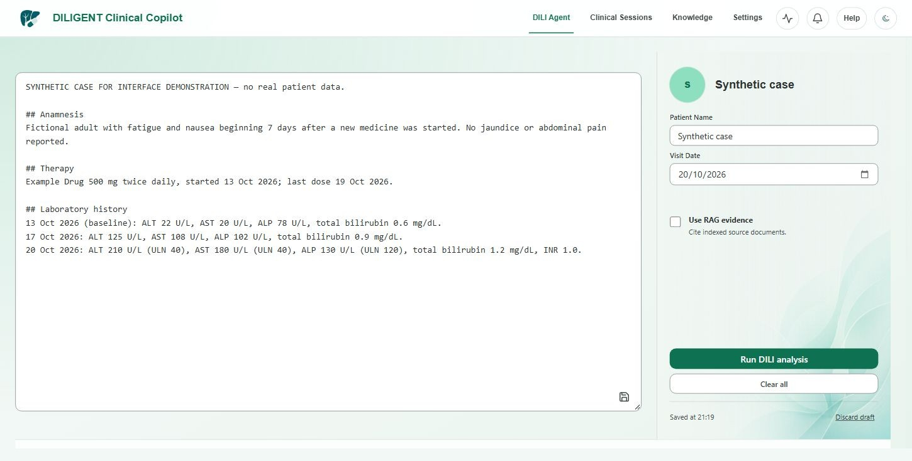
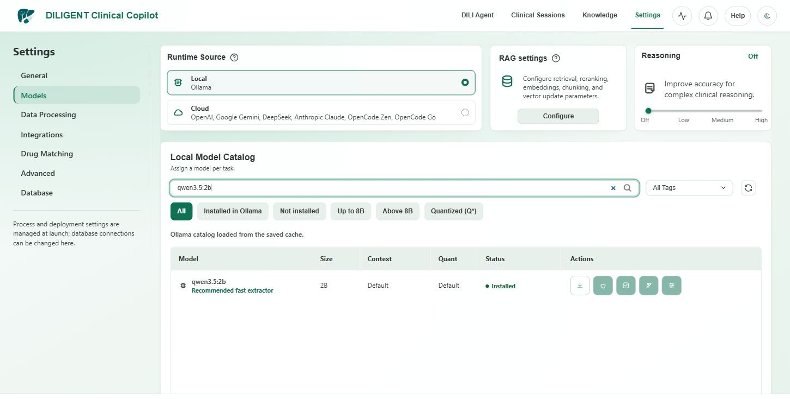
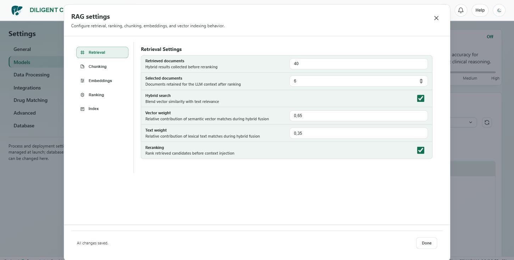

<p align="center">
  
</p>

<h1 align="center">DILIGENT Clinical Copilot</h1>

<p align="center">A local, single-user workspace for structured review of possible drug-induced liver injury (DILI).</p>

<p align="center">
  <a href="https://github.com/CTCycle/DILIGENT-Clinical-Copilot/stargazers"></a>
  <a href="https://github.com/CTCycle/DILIGENT-Clinical-Copilot/commits"></a>
  <a href="https://github.com/CTCycle/DILIGENT-Clinical-Copilot/releases"></a>
  <a href="LICENSE"></a>
</p>

<p align="center">
  
  
  <a href="https://www.microsoft.com/windows"></a>
  <a href="https://github.com/CTCycle/DILIGENT-Clinical-Copilot/actions/workflows/ci.yml"></a>
</p>

<p align="center">
  <a href="#what-it-does">Overview</a> ·
  <a href="#screenshots">Screenshots</a> ·
  <a href="#run-on-windows">Run on Windows</a> ·
  <a href="#typical-workflow">Workflow</a> ·
  <a href="#documentation">Documentation</a>
</p>

> **Clinical decision support only.** DILIGENT does not diagnose or replace clinical judgment. Review the source data and every generated statement. Before entering patient information, check your institution’s policy: text sent to a hosted model provider leaves the local machine.

## What it does

DILIGENT brings a structured DILI assessment workflow, saved clinical sessions, and local knowledge resources into one desktop application. It helps clinicians organize medication exposure and liver-test timelines, review a model-generated draft, and keep the source material available for follow-up.

The app runs as a single-user desktop application on Windows. It is designed for a wide desktop window (about 1100 px or more), not a phone-sized screen.

## Screenshots

The first image shows a saved fictional draft. It is an interface example only; no clinical analysis has been run.



### Assessment and sessions

- Enter the clinical context, liver tests, and suspected medication exposures in the DILI Agent.
- Review preflight checks and warnings before running an assessment.
- Optionally include the configured retrieval-augmented generation (RAG) sources for an assessment.
- Save and resume an unfinished draft. Completed reports and revisions are available in Clinical Sessions, with a contextual Timeline.

### Models and knowledge

Model providers and roles are configured in Settings. Local Ollama models and supported hosted providers can be selected; provider availability depends on the configured endpoint and credentials.



The Knowledge area presents configured drug and liver-injury references, including RxNav, LiverTox, and FDA DILIrank 2.0. DILIrank is a drug-level hepatotoxicity reference, not a patient-specific causality result. RAG settings control candidate counts, hybrid search, and reranking when retrieval is enabled.



## Run on Windows

### Packaged release

Download the portable executable or MSI installer from [Releases](https://github.com/CTCycle/DILIGENT-Clinical-Copilot/releases). The desktop app uses the Windows WebView2 runtime.

### Run from source

The repository includes a PowerShell launcher. From the repository root, run:

```powershell
.\start_on_windows.ps1 -Action Launch
```

The launcher prepares and starts the local app. Keep its window open while using DILIGENT. By default, the source app is available at `http://127.0.0.1:7690`. See [Getting started](assets/docs/user/getting_started.md) for setup details and [runtime modes](assets/docs/runtime/modes.md) for development options.

## Typical workflow

1. In **Settings → Models**, choose Local or Cloud and assign a model to each role. Add provider credentials if you use a hosted provider.
2. In **DILI Agent**, enter the clinical context, dated laboratory results, and suspected medication exposures.
3. Resolve or acknowledge the preflight warnings, then run the assessment.
4. Review the generated report against the source data; revise it as needed.
5. Save the report and continue follow-up from **Clinical Sessions** and its **Timeline**.

Reports are drafts for clinician review. A model’s output can be incomplete or incorrect.

## Data and configuration

DILIGENT stores application data locally by default. In source mode, the default data directory is `data`; set `DILIGENT_DATA_PATH` to use another location. Packaged builds store data under `%LOCALAPPDATA%\DILIGENT\data`. SQLite is the default database, and PostgreSQL can be configured in Settings. Database connection configuration is stored separately from application settings.

Local storage does not mean every operation stays local: a hosted model provider may receive the clinical text sent for an assessment. Review your organization’s policy before using real patient data. See [configuration](assets/docs/runtime/configuration.md) for data paths and settings.

## Technology

| Area | Implementation |
| --- | --- |
| Desktop shell | Tauri 2 |
| API and local server | Python 3.14+, FastAPI |
| Web interface | Angular 21, TypeScript |
| Database | SQLite by default; optional PostgreSQL |
| Knowledge retrieval | Optional RAG over configured sources |

## Documentation

- [Getting started](assets/docs/user/getting_started.md)
- [DILI assessment workflow](assets/docs/user/dili_assessment_workflow.md)
- [Clinical sessions, timeline, and data](assets/docs/user/sessions_timeline_and_data.md)
- [Runtime modes](assets/docs/runtime/modes.md)
- [Configuration](assets/docs/runtime/configuration.md)
- [Project documentation index](assets/docs/project_index.md)

## Contributing

Issues and pull requests are welcome. For a focused change, include the relevant reproduction steps or screenshots and describe which workflow you verified.

## License

DILIGENT is distributed under the [GNU General Public License v3.0 or later](LICENSE).

---

_Last updated: 2026-10-28_
