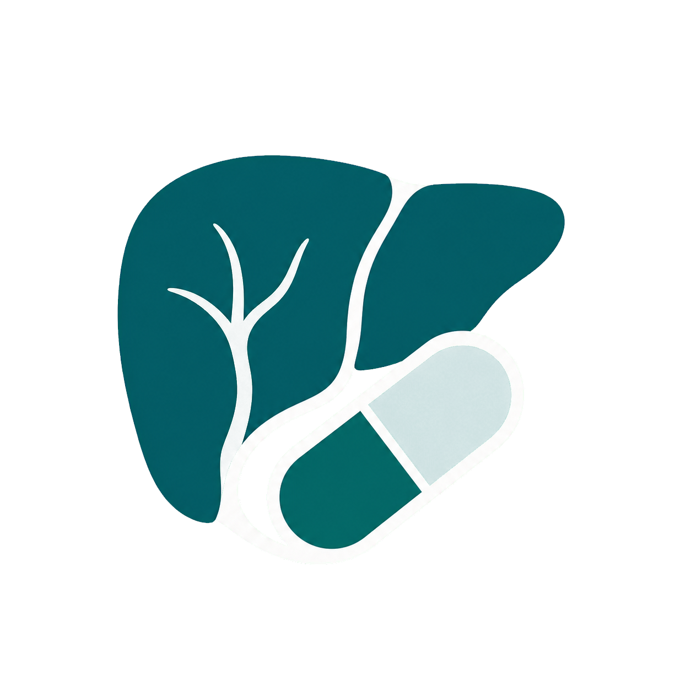
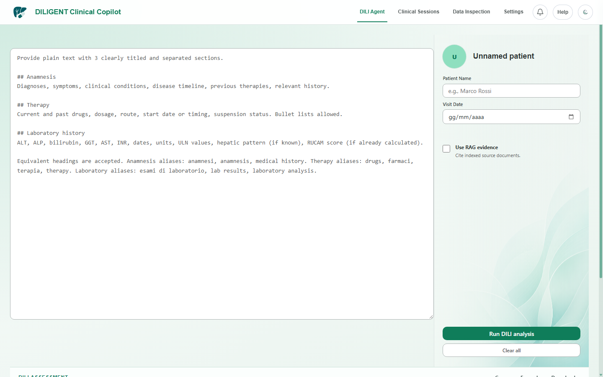
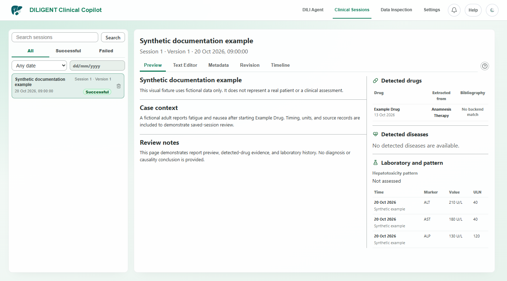
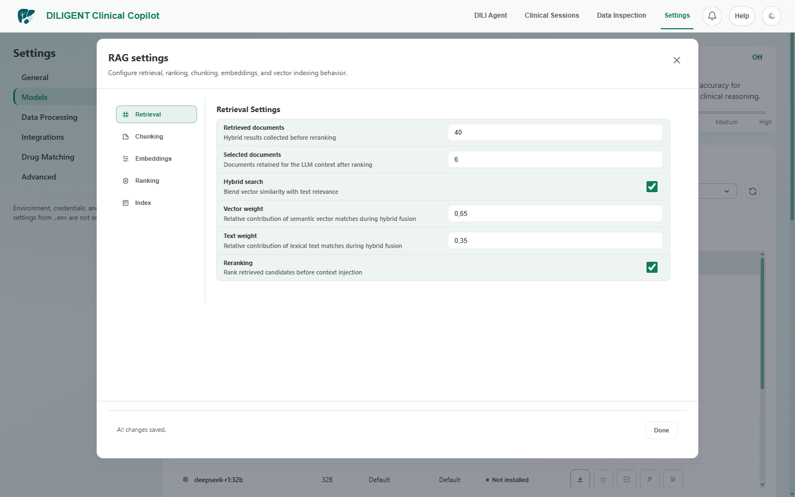

<p align="center">
  
</p>

<h1 align="center">DILIGENT Clinical Copilot</h1>

<p align="center"><strong>A local, single-user decision-support tool for structured review of possible drug-induced liver injury (DILI).</strong></p>

<p align="center">
  <a href="LICENSE"></a>
  <a href="https://github.com/CTCycle/DILIGENT-Clinical-Copilot/releases"></a>
  <a href="https://github.com/CTCycle/DILIGENT-Clinical-Copilot/actions/workflows/ci.yml?query=branch%3Adevelop"></a>
</p>

<p align="center">
  <a href="app/server/pyproject.toml"></a>
  <a href="app/client/package.json"></a>
  <a href="https://www.microsoft.com/windows"></a>
</p>

## Overview

DILIGENT brings clinical history, medication exposure, symptoms, laboratory results, and timing information together for a reviewable DILI assessment. It supports local or cloud model providers, optional retrieval from prepared reference data, saved clinical sessions, timeline review, and report export.

> **Decision support only.** DILIGENT does not diagnose or replace clinical judgment. Verify the source information and generated statements before use. Cloud-backed assessments may send case text to the configured provider; confirm local policy before entering protected health information.

## Key Features

- Enter case context and resolve preflight feedback before running an assessment.
- Review the generated narrative alongside structured findings, medication matches, and uncertainty signals.
- Save sessions, compare revisions, review timelines, and export reports.
- Inspect local drug catalogs and reference resources, and configure model providers, roles, access keys, and retrieval options.

## Screenshots

Enter a fictional case in the DILI Agent. The analysis has not been run.



Review a saved, synthetic documentation example. It does not represent a real patient, clinical assessment, or model output.



Review retrieval and ranking options in Settings; the autosave status is visible in the dialog.



## Technology Stack

- Python 3.14+ and FastAPI for the local backend.
- Angular 21 with Node.js 22 for the web client.
- SQLite for local application data.
- Tauri 2 for the Windows desktop package.

## Installation and Usage

For the Windows desktop app, download the portable EXE or MSI installer from [GitHub Releases](https://github.com/CTCycle/DILIGENT-Clinical-Copilot/releases). WebView2 is required. The package includes its application runtime.

To run from source on Windows, open PowerShell at the repository root and start the launcher:

```powershell
.\start_on_windows.ps1
```

Choose **Install dependencies**, then **Launch application**. The source-mode UI opens at `http://127.0.0.1:9847` by default.

## Configuration

Choose a local or cloud model provider and assign model roles in **Settings**. Source-mode environment settings are stored in `settings/.env`; the launcher creates it from `settings/.env.example` when needed. Keep provider credentials private.

Editing a saved report can clear its saved attachment and session metadata. Re-enter any required metadata after editing.

## Documentation

- [Getting started](assets/docs/user/getting_started.md)
- [Model setup and access keys](assets/docs/user/model_setup.md)
- [DILI assessment workflow](assets/docs/user/dili_assessment_workflow.md)
- [Sessions, timeline, and data](assets/docs/user/sessions_timeline_and_data.md)
- [Troubleshooting](assets/docs/user/troubleshooting.md)

## License

DILIGENT is licensed under the GNU General Public License, version 3 or later. See [LICENSE](LICENSE) for the terms.
