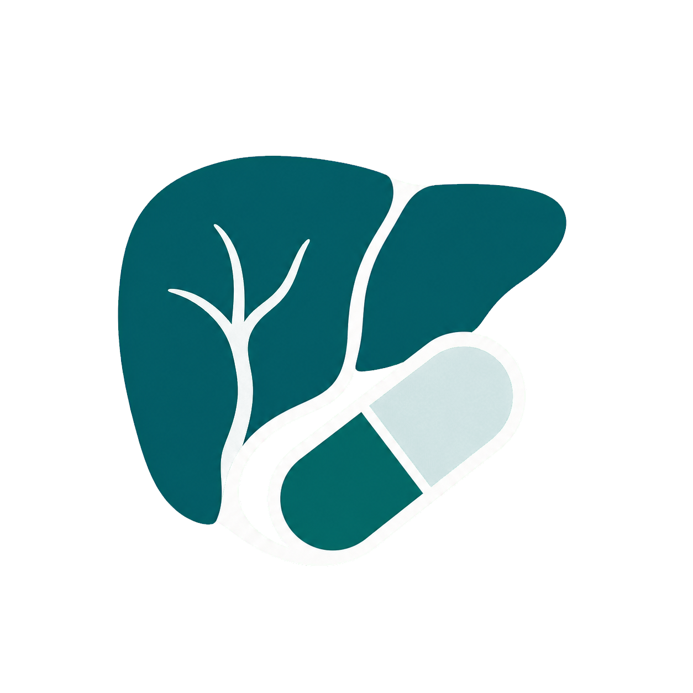
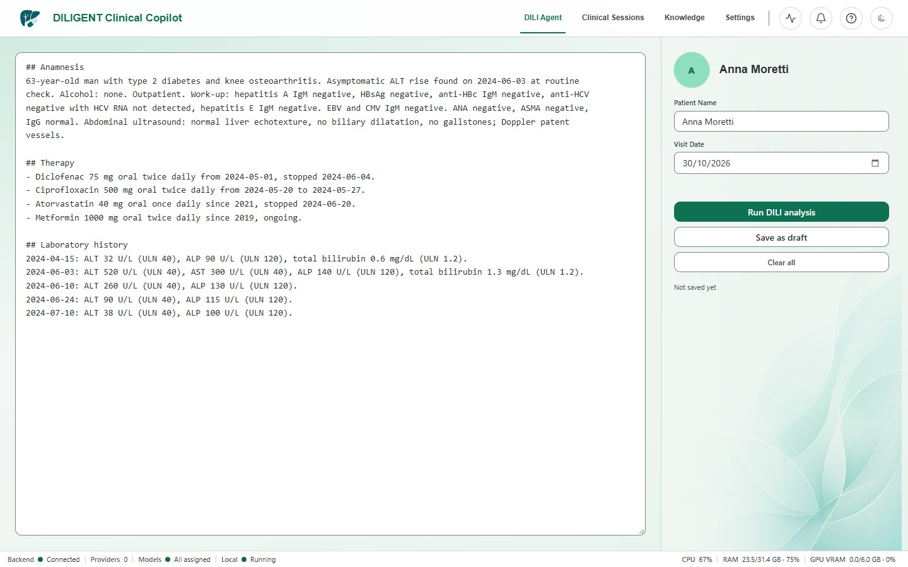
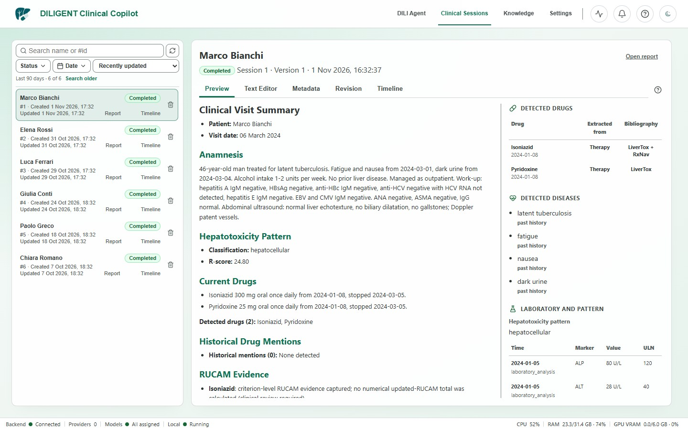
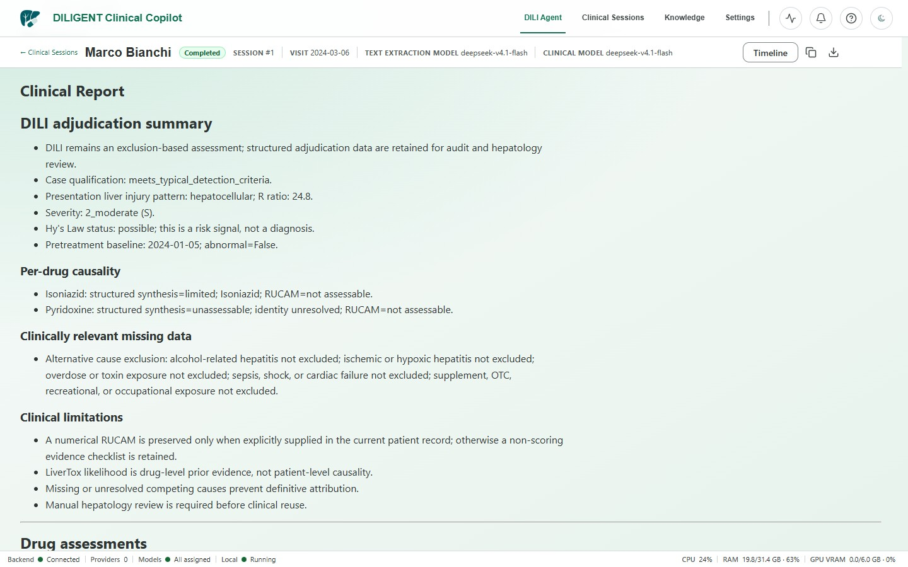
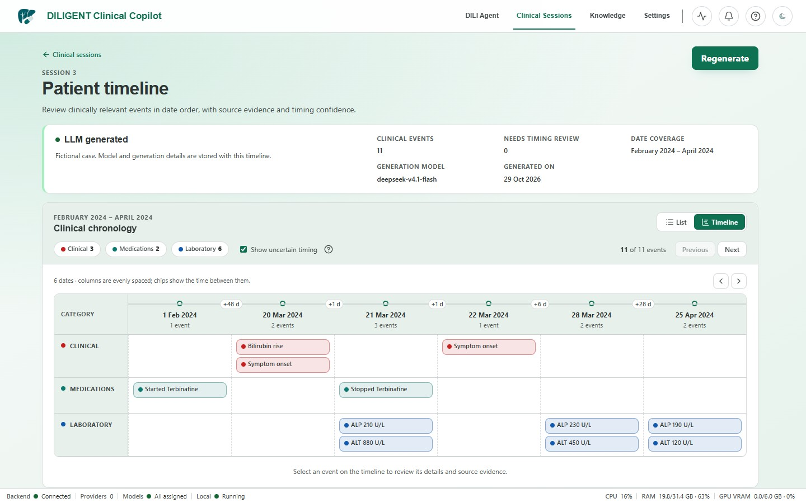
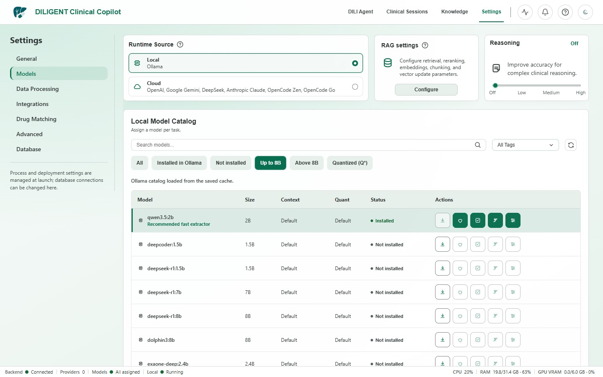
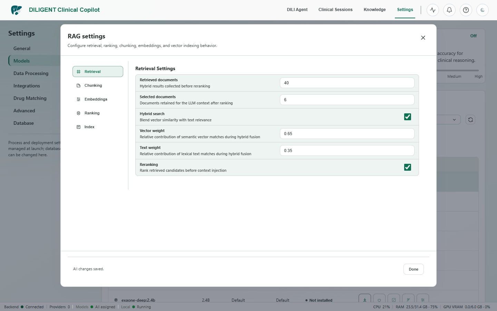
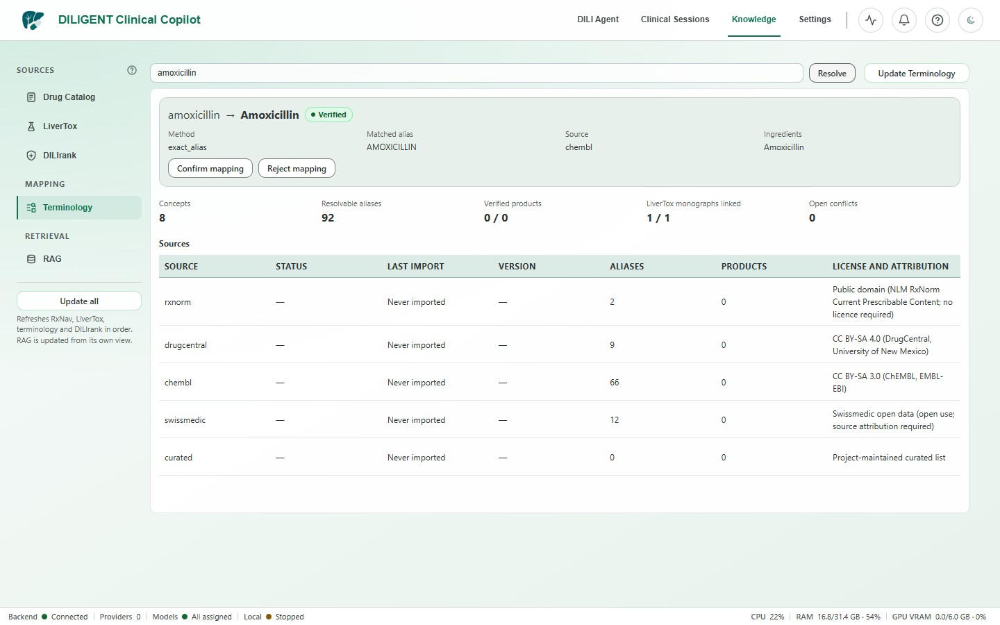

<p align="center">
  
</p>

<h1 align="center">DILIGENT Clinical Copilot</h1>

<p align="center">A local, single-user workspace for structured review of possible drug-induced liver injury (DILI).</p>

<p align="center">
  <a href="https://github.com/CTCycle/DILIGENT-Clinical-Copilot/stargazers"></a>
  <a href="https://github.com/CTCycle/DILIGENT-Clinical-Copilot/commits"></a>
  <a href="https://github.com/CTCycle/DILIGENT-Clinical-Copilot/releases"></a>
  <a href="LICENSE"></a>
</p>

<p align="center">
  
  
  <a href="https://www.microsoft.com/windows"></a>
  <a href="https://github.com/CTCycle/DILIGENT-Clinical-Copilot/actions/workflows/ci.yml"></a>
</p>

<p align="center">
  <a href="#what-it-does">Overview</a> ·
  <a href="#screenshots">Screenshots</a> ·
  <a href="#run-on-windows">Run on Windows</a> ·
  <a href="#typical-workflow">Workflow</a> ·
  <a href="#documentation">Documentation</a>
</p>

> **Clinical decision support only.** DILIGENT does not diagnose or replace clinical judgment. Review the source data and every generated statement. Before entering patient information, check your institution’s policy: text sent to a hosted model provider leaves the local machine.

## What it does

DILIGENT brings a structured DILI assessment workflow, saved clinical sessions, and local knowledge resources into one desktop application. It helps clinicians organize medication exposure and liver-test timelines, review a model-generated report, and keep the source material available for follow-up.

- **DILI Agent** – enter or paste the anamnesis, therapy, and dated laboratory results; choose evidence sources and optional per-run model overrides; review preflight checks, then run the assessment. Unfinished input can be saved as a draft.
- **Clinical Sessions** – every analysis is a session with a visible lifecycle (queued, running, completed, failed, cancelled). Search and filter sessions, open the report, review metadata and attachments, and revise the report with version tracking.
- **Patient Timeline** – a date-grounded chronology of medication, clinical, and laboratory events with source evidence, available as a list or a horizontal timeline.
- **Knowledge** – local drug and liver-injury references (RxNav, LiverTox, FDA DILIrank 2.0), a drug terminology mapper (RxNorm, DrugCentral, ChEMBL, Swissmedic) with reviewer decisions, and optional RAG over your own documents.
- **Settings** – local Ollama or hosted model providers per role, runtime and network options, drug matching, and a SQLite or PostgreSQL database.

The app runs as a single-user application on Windows, either as the packaged desktop app or from source in a browser. It is designed for a wide desktop window (about 1100 px or more), not a phone-sized screen.

## Screenshots

All screenshots show the running application with fictional patients. Reports were produced by the assessment pipeline from synthetic cases; no real patient data is shown.









### Models and retrieval

Model providers and roles are configured in Settings. Local Ollama models and supported hosted providers can be selected; provider availability depends on the configured endpoint and credentials.



RAG settings control candidate counts, hybrid search, and reranking when retrieval is enabled. DILIrank is a drug-level hepatotoxicity reference, not a patient-specific causality result.



### Knowledge and drug terminology

Knowledge → Terminology resolves a drug name, brand, or abbreviation against the locally imported terminology. Ambiguous matches can be confirmed or rejected by a reviewer. The capture below uses a small test fixture, not a full import.



## Run on Windows

### Packaged release

Download one of the Windows x64 builds from [Releases](https://github.com/CTCycle/DILIGENT-Clinical-Copilot/releases) and verify it against the published `.sha256` file:

| Download | Use it when |
| --- | --- |
| `DILIGENT-vX.Y.Z-windows-x64.msi` | You want a standard installation with an uninstall entry. Installing a newer MSI upgrades in place and keeps your data. |
| `DILIGENT-vX.Y.Z-windows-x64-portable.exe` | You want a single executable with no installation. It extracts its runtime under `%LOCALAPPDATA%\DILIGENT\rt` on first launch. |

Both builds are unsigned, so Windows SmartScreen may show an unknown-publisher prompt. Both use the Windows WebView2 runtime and keep settings and data in `%LOCALAPPDATA%\DILIGENT\data`; uninstalling the MSI or deleting the portable EXE does not remove that data.

### Run from source

The repository includes a PowerShell launcher. From the repository root, run:

```powershell
.\start_on_windows.bat
```

The batch launcher prepares and starts the local app. Keep its window open while using DILIGENT. Run pwsh .\setup_and_maintenance.ps1 to open the setup and maintenance menu. By default, the source app is available at `http://127.0.0.1:7690`. See [Getting started](assets/docs/user/getting_started.md) for setup details and [runtime modes](assets/docs/runtime/modes.md) for development options.

## Typical workflow

1. In **Settings → Models**, choose Local or Cloud and assign a model to each role. Add provider credentials if you use a hosted provider.
2. In **DILI Agent**, enter the clinical context, dated laboratory results, and suspected medication exposures.
3. Resolve or acknowledge the preflight warnings, then run the assessment.
4. Follow progress from the session page; queued or running analyses can be cancelled.
5. Review the generated report against the source data; revise it as needed and continue follow-up from **Clinical Sessions** and its **Timeline**.

Reports are drafts for clinician review. A model’s output can be incomplete or incorrect.

## Data and configuration

DILIGENT stores application data locally by default. In source mode, the default data directory is `data`; set `DILIGENT_DATA_PATH` to use another location. Packaged builds store data under `%LOCALAPPDATA%\DILIGENT\data`. SQLite is the default database, and PostgreSQL can be configured in Settings. Database connection configuration is stored separately from application settings.

Local storage does not mean every operation stays local: a hosted model provider may receive the clinical text sent for an assessment. Review your organization’s policy before using real patient data. See [configuration](assets/docs/runtime/configuration.md) for data paths and settings.

## Technology

| Area | Implementation |
| --- | --- |
| Desktop shell | Tauri 2 |
| API and local server | Python 3.14+, FastAPI |
| Web interface | Angular 21, TypeScript |
| Database | SQLite by default; optional PostgreSQL |
| Knowledge retrieval | Optional RAG over configured sources |

## Documentation

- [Getting started](assets/docs/user/getting_started.md)
- [DILI assessment workflow](assets/docs/user/dili_assessment_workflow.md)
- [Clinical sessions, timeline, and data](assets/docs/user/sessions_timeline_and_data.md)
- [Runtime modes](assets/docs/runtime/modes.md)
- [Configuration](assets/docs/runtime/configuration.md)
- [Changelog](CHANGELOG.md)
- [Project documentation index](assets/docs/project_index.md)

## Contributing

Issues and pull requests are welcome. For a focused change, include the relevant reproduction steps or screenshots and describe which workflow you verified.

## License

DILIGENT is distributed under the [GNU General Public License v3.0 or later](LICENSE).

---

_Last updated: 2026-11-02_
