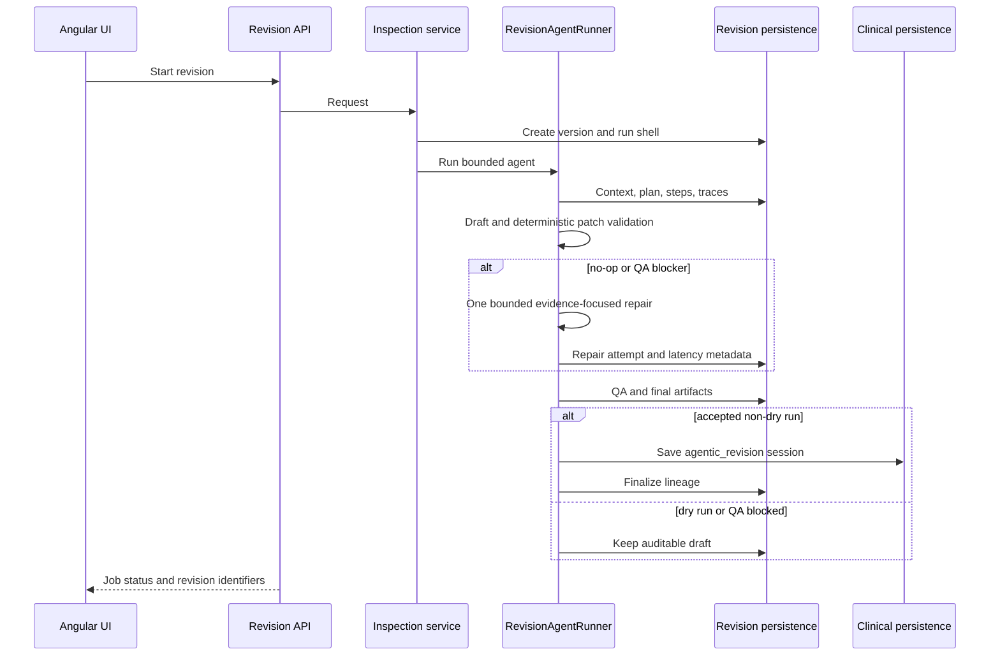

# API Surface
Last updated: 2026-10-29

`/api/model-config` manages provider, model, reasoning, and RAG selection; it
does not expose sampling temperature. `GET` returns the rich catalog and
runtime-status view. `PUT` is a persistence-only response containing the
saved configuration and timestamp; catalog and embedding refreshes remain
explicit GET/status operations.

The persisted role assignments are independent: `clinical_model`,
`text_extraction_model`, `revision_model`, and `timeline_model`. Revision and
Timeline job requests do not accept active model overrides; each job resolves
its configured role when it starts. Cloud model descriptors expose capability
data through the canonical `model_capabilities` object only.

## Stable Boundary
All business APIs are mounted under `/api`. The frontend uses `/api` as the stable frontend-backend boundary.

## Root and OpenAPI Routes
- `GET /`
- `GET /docs`
- `GET /redoc`
- `GET /openapi.json`

## Session And Clinical Routes
- `GET /api/health`
- `GET /api/system/status` (non-cacheable, always HTTP 200: provider availability, Ollama reachability at the configured endpoint, and system-wide CPU, RAM and GPU VRAM; unavailable readings are `null`)
- `GET /api/jobs` (non-cacheable summary of active and recent jobs for the global Jobs monitor)
- `DELETE /api/jobs/{job_id}` (cooperative cancel; refused for `session_revision` and `session_timeline`, which are cancelled from their own pages)
- `GET /api/clinical/section-template`
- `GET /api/clinical/draft`
- `PUT /api/clinical/draft`
- `DELETE /api/clinical/draft?expected_revision={n}&expected_draft_key={uuid}`
- `POST /api/clinical/validate-input`
- `POST /api/clinical/jobs`
- `GET /api/clinical/jobs/{job_id}`
- `DELETE /api/clinical/jobs/{job_id}`

`POST /api/clinical/validate-input` includes optional `rag_readiness` metadata when evaluating a submission. It reports whether RAG was requested, whether the configured embedding backend is available, the backend and model names, and a user-safe reason when retrieval cannot start.

The draft routes persist one opt-in DILI Agent working draft in the active
configured database. `PUT` requires `expected_revision`, `expected_draft_key`,
and a form containing only `patient_name`, `visit_date`, `clinical_input`, and
`use_rag`. The text is preserved as submitted and is limited to 100,000
characters. `GET` and successful writes return a snapshot with the UUID,
revision, update time, and form (null when no recoverable draft exists).
`DELETE` uses the revision and optional UUID as compare-and-swap tokens, clears
patient fields, and returns a tombstone. Stale tokens return `409`; validation
failures return a generic `422`; unavailable persistence returns `503`. Every
draft response uses `Cache-Control: no-store`, and draft validation errors do
not echo submitted data.

## Model Catalog And Pull Routes
- `GET /api/models/list`
- `POST /api/models/pull/jobs`
- `GET /api/models/jobs/{job_id}`
- `DELETE /api/models/jobs/{job_id}`

## Model Configuration Routes
- `GET /api/model-config`
- `PUT /api/model-config`
- `POST /api/model-config/catalogs/{provider}/load`
- `POST /api/model-config/catalogs/{provider}/refresh`
- `GET /api/model-config/embedding-status`
- `POST /api/model-config/connectivity-check`

`GET /api/model-config` returns each cloud provider's model catalog together with
freshness status and a user-safe message. Catalogs are refreshed through the
provider's official model-list API; a successful in-process result is returned
as `cached` if a later refresh fails. Successful and failed catalog attempts are
persisted in the SQLAlchemy-backed provider catalog cache, so cached catalog
state survives a backend restart.
If a persisted model is no longer present in its provider's refreshed catalog,
the GET response still returns that saved selection together with the current
catalog so clients can present a valid replacement. Catalog membership remains
strictly validated when a new provider or model selection is saved. Responses
are non-cacheable so model selectors and their Retry actions always observe the
latest saved configuration and provider-catalog state.

## Access Key Routes
- `GET /api/access-keys`
- `POST /api/access-keys`
- `PUT /api/access-keys/{key_id}/activate`
- `DELETE /api/access-keys/{key_id}`

`GET /api/access-keys` accepts the optional `provider` query parameter with
one of `openai`, `gemini`, `deepseek`, `anthropic`, `opencode`, or `brave`.

## Runtime Settings Routes
- `GET /api/settings`
- `PATCH /api/settings`
- `POST /api/settings/reset/{category}`

## Desktop Runtime Routes
- `POST /api/desktop/bootstrap`
- `POST /api/desktop/shutdown`

## Inspection Routes
- `GET /api/inspection/jobs`
- `GET /api/inspection/sessions`
- `GET /api/inspection/sessions/{session_id}`
- `GET /api/inspection/sessions/{session_id}/versions`
- `GET /api/inspection/sessions/{session_id}/versions/{version_id}`
- `PUT /api/inspection/sessions/{session_id}`
- `PUT /api/inspection/sessions/{session_id}/report`
- `GET /api/inspection/sessions/{session_id}/manual-edits`
- `POST /api/inspection/sessions/{session_id}/revision/jobs`
- `GET /api/inspection/sessions/revision/pipeline-runs/{pipeline_run_id}`
- `POST /api/inspection/sessions/revision/pipeline-runs/{pipeline_run_id}/retry`
- `GET /api/inspection/sessions/revision/pipeline-runs/{pipeline_run_id}/steps`
- `PUT /api/inspection/sessions/{session_id}/versions/{version_id}/clinical-review`
- `GET /api/inspection/sessions/revision/jobs/{job_id}`
- `DELETE /api/inspection/sessions/revision/jobs/{job_id}`
- `GET /api/inspection/sessions/{session_id}/versions/{version_id}/entities`
- `GET /api/inspection/sessions/{session_id}/versions/{version_id}/reviews`
- `GET /api/inspection/sessions/{session_id}/versions/{version_id}/artifacts`
- `GET /api/inspection/sessions/{session_id}/timelines`
- `GET /api/inspection/sessions/{session_id}/timelines/{timeline_id}`
- `DELETE /api/inspection/sessions/{session_id}/timelines/{timeline_id}`
- `POST /api/inspection/sessions/{session_id}/timeline-jobs`
- `GET /api/inspection/sessions/{session_id}/timeline-jobs/{job_id}`
- `DELETE /api/inspection/sessions/{session_id}/timeline-jobs/{job_id}`
- `DELETE /api/inspection/sessions/{session_id}`
- `GET /api/inspection/rxnav`
- `GET /api/inspection/rxnav/{drug_id}/aliases`
- `DELETE /api/inspection/rxnav/{drug_id}`
- `GET /api/inspection/rxnav/update-config`
- `POST /api/inspection/rxnav/jobs`
- `GET /api/inspection/rxnav/jobs/{job_id}`
- `DELETE /api/inspection/rxnav/jobs/{job_id}`
- `GET /api/inspection/terminology/summary`
- `GET /api/inspection/terminology/runs`
- `GET /api/inspection/terminology/conflicts`
- `POST /api/inspection/terminology/resolve`
- `POST /api/inspection/terminology/aliases/confirm`
- `POST /api/inspection/terminology/aliases/reject`
- `GET /api/inspection/terminology/update-config`
- `POST /api/inspection/terminology/jobs`
- `GET /api/inspection/terminology/jobs/{job_id}`
- `DELETE /api/inspection/terminology/jobs/{job_id}`
- `GET /api/inspection/livertox`
- `GET /api/inspection/livertox/{drug_id}/excerpt`
- `DELETE /api/inspection/livertox/{drug_id}`
- `GET /api/inspection/livertox/update-config`
- `POST /api/inspection/livertox/jobs`
- `GET /api/inspection/livertox/jobs/{job_id}`
- `DELETE /api/inspection/livertox/jobs/{job_id}`
- `GET /api/inspection/dilirank`
- `GET /api/inspection/dilirank/{drug_id}`
- `GET /api/inspection/dilirank/update-config`
- `POST /api/inspection/dilirank/jobs`
- `GET /api/inspection/dilirank/jobs/{job_id}`
- `DELETE /api/inspection/dilirank/jobs/{job_id}`
- `POST /api/inspection/structured-sources/jobs`
- `GET /api/inspection/structured-sources/jobs/{job_id}`
- `DELETE /api/inspection/structured-sources/jobs/{job_id}`
- `GET /api/inspection/reference-catalogs/runtime-observations`
- `GET /api/inspection/reference-catalogs/runtime-observations/{category}`
- `PUT /api/inspection/reference-catalogs/runtime-observations/{category}`
- `DELETE /api/inspection/reference-catalogs/runtime-observations/{category}/{term}`
- `GET /api/inspection/rag/update-config`
- `GET /api/inspection/rag/documents`
- `GET /api/inspection/rag/vector-store`
- `GET /api/inspection/rag/browse`
- `POST /api/inspection/rag/jobs`
- `GET /api/inspection/rag/jobs/{job_id}`
- `DELETE /api/inspection/rag/jobs/{job_id}`

## Notes
- DILIrank inspection is read-only at record level. `GET /api/inspection/dilirank` exposes the complete persisted FDA snapshot, including rows that are intentionally unlinked to the local canonical drug catalog. The update routes use the same centralized inspection job manager as RxNav, LiverTox, terminology, the combined structured-source workflow, and RAG. `redownload=true` forces a fresh FDA workbook; otherwise conditional HTTP metadata is used when a validated cache exists.
- `POST /api/inspection/structured-sources/jobs` starts the dependency-aware `RxNav -> LiverTox -> Terminology -> DILIrank` sequence and returns child source state in the job result. RAG is intentionally excluded and remains independently controllable.
- Terminology routes: `summary` reports per-source versions, last runs, counts, license and attribution, open conflicts and fuzzy-index statistics; `resolve` is the try-it resolver (`allow_external` controls the RxNav fallback); `aliases/confirm` and `aliases/reject` store reviewer decisions as `reviewer` aliases (`404` for an unknown concept). `POST /api/inspection/rxnav/jobs` accepts only `force_full`; `POST /api/inspection/terminology/jobs` accepts `force_full`, `drugcentral_enabled`, `chembl_enabled` and `swissmedic_enabled`. See [drug_terminology.md](drug_terminology.md).
- `POST /api/inspection/sessions/{session_id}/timeline-jobs` accepts
  `force_regenerate` and returns a job for polling. The job resolves the
  persisted `timeline_model` role at start; provider/model controls are managed
  from Settings → Models. Timeline previews include source-evidence,
  missing-evidence, uncertain, and undated counts.
- Timeline deletion is scoped by both session and timeline identifiers and returns 404
  when that exact persisted timeline does not exist.
- Clinical and inspection workflows rely on job polling for long-running work.
  Angular feature trackers use the shared `JobPollingService`.
- Revision jobs expose the implemented bounded revision workflow: start and
  status, persisted run/context/plan/step/tool-trace/artifact reads, draft
  report validation, QA, optional `agentic_revision` session creation, and
  lineage/review reads. Dry runs and QA-blocked runs retain an auditable draft;
  an accepted non-dry run finalizes the revision lineage.
- Research has no active route inventory in the current architecture source and should not be documented as an active API surface until implemented.

### Session revision agent
`POST /api/inspection/sessions/{session_id}/revision/jobs` starts an agentic
revision job. Existing status, cancellation, pipeline-run, step, artifact,
entity, and clinical-review routes remain stable. The job returns
revision/version identifiers and task, tool, QA, and human-review summaries.

