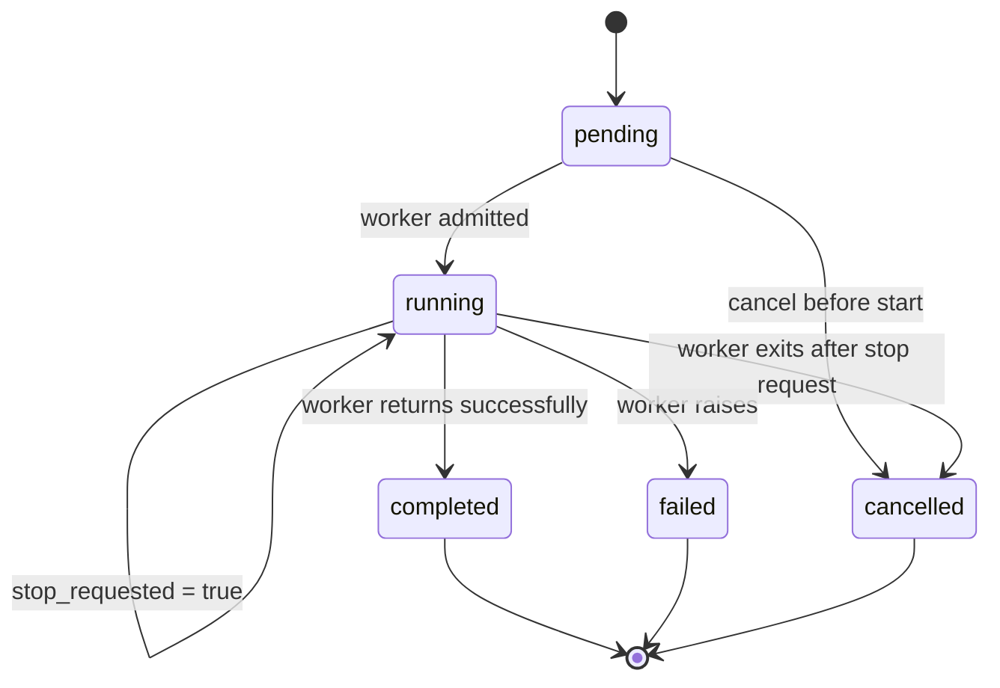

# Background Jobs
Last updated: 2026-10-27

## Scope
DILIGENT uses a centralized thread-based job manager for long-running operations.

## Core Components
- Manager: `app/server/services/runtime/jobs.py`
- Shared in-process access point: `get_job_manager()`
- API models: `app/server/domain/jobs.py`
- Runtime state: `app/server/services/runtime/state.py`

## Job State Contract
Each job tracks:
- `job_id`
- `job_type`
- `status`: `pending`, `running`, `completed`, `failed`, `cancelled`
- `progress`
- `result`
- `error`
- `created_at`
- `completed_at`
- `version`
- `stop_requested`

`stop_requested` is a control signal, not a terminal status. A running job
continues to report `running` while its worker is unwinding, which keeps its
concurrency scope occupied and makes the API truthful about worker lifetime.

## Execution Behavior
- Jobs run in daemon threads.
- Job execution state is process-local. Clinical and update job ids are not durable across backend restarts.
- Revision runs are persisted separately from the in-memory job state; startup reconciliation marks stale `running` revision runs as failed/recoverable when no in-process worker can own them.
- `start_job` can auto-inject `job_id` into runners.
- `update_result` merges interim patches with final payload.
- Unhandled runner exceptions mark the job `failed` unless cancellation was requested.
- Detailed exception traces remain in server logs only.

## Active Job Types
- `clinical`
  - Preflight: `POST /api/clinical/validate-input`
  - Start: `POST /api/clinical/jobs`
  - Poll or cancel: `GET|DELETE /api/clinical/jobs/{job_id}`
- `ollama_pull`
  - Start: `POST /api/models/pull/jobs`
  - Poll or cancel: `GET|DELETE /api/models/jobs/{job_id}`
- `rxnav_update`
  - Start: `POST /api/inspection/rxnav/jobs`
  - Poll or cancel: `GET|DELETE /api/inspection/rxnav/jobs/{job_id}`
- `livertox_update`
  - Start: `POST /api/inspection/livertox/jobs`
  - Poll or cancel: `GET|DELETE /api/inspection/livertox/jobs/{job_id}`
- `dilirank_update`
  - Start: `POST /api/inspection/dilirank/jobs`
  - Poll or cancel: `GET|DELETE /api/inspection/dilirank/jobs/{job_id}`
- `structured_sources_update`
  - Start: `POST /api/inspection/structured-sources/jobs`
  - Poll or cancel: `GET|DELETE /api/inspection/structured-sources/jobs/{job_id}`
- `rag_update`
  - Start: `POST /api/inspection/rag/jobs`
  - Poll or cancel: `GET|DELETE /api/inspection/rag/jobs/{job_id}`
- `session_timeline`
  - Start: `POST /api/inspection/sessions/{session_id}/timeline-jobs`
  - Poll or cancel: `GET|DELETE /api/inspection/sessions/{session_id}/timeline-jobs/{job_id}`
- `session_revision`
  - Start: `POST /api/inspection/sessions/{session_id}/revision/jobs`
  - Poll or cancel: `GET|DELETE /api/inspection/sessions/revision/jobs/{job_id}`

## Polling Contract
1. Start endpoints return `JobStartResponse` with `job_id`, `status`, and `poll_interval`.
2. Status endpoints return `JobStatusResponse`.
3. Cancel endpoints return `JobCancelResponse`.

Additional rules:
- Clinical status responses are explicitly non-cacheable through `Cache-Control: no-store`.
- Clients should treat `version` as monotonic and ignore out-of-order older snapshots.
- Clinical progress snapshots expose canonical granular stage keys such as `drugs.extracting`, `retrieval.evidence`, `report.generating`, `session.saving`, and terminal `completed`; generic internal wrapper stages are not persisted as the user-facing stage.
- Inspection update jobs may include `phase`, `step_index`, `step_count`, `progress_message`, and `summary`.
- Inspection update runners use cooperative cancellation and progress callbacks consistently across `rxnav`, `livertox`, `dilirank`, and `rag` through the same `DataInspectionService` and `DataInspectionUpdateJobRunner` path.
- The combined structured-source job owns the dependency order `RxNav -> LiverTox -> DILIrank`; DILIrank linking starts only after the preceding identity/catalog phases complete. RAG remains an independent job and is not part of this sequence.
- Full RxNav and LiverTox refreshes prepare source snapshots before replacing source-owned canonical rows. Cancellation or failure before the final transaction leaves the previous usable snapshot intact.
- Inspection clients distinguish a transient polling failure from a lost in-memory job. Repeated failures are bounded, and a confirmed missing job is surfaced as a recoverable interrupted update rather than polled forever.
- DILIrank refreshes validate a downloaded candidate workbook before promoting it to the stable cache. Validation failure or cancellation before promotion removes the candidate and preserves the last-known-good cached workbook and metadata.
- Session revision jobs start the bounded revision agent. It creates a draft
  version and run, persists context and a plan, executes allow-listed tool
  iterations, validates the draft report, runs QA, and persists step, trace,
  and artifact data before finalizing or retaining the draft.
- Missing in-memory revision job status returns a recoverable failed status instead of a bare not-found response so the frontend can reload the persisted revision run and offer retry when the draft shell is still valid.
- Clinical and session revision jobs must persist their successful result payloads before returning completion. Persistence failures move the job to failed state with sanitized error metadata.

Frontend polling is implemented through the shared
`app/client/src/app/core/services/job-polling.service.ts`, with feature trackers
such as `dili-job-tracker.service.ts` interpreting status and progress. Active
DILI job linkage is persisted in local storage so the UI can reattach after
route navigation, page refresh, or browser close/reopen while the backend
worker is still running. Clinical status requests use the global one-hour HTTP
timeout; the request timeout is independent from the worker duration because
polling does not execute the clinical job inline.

## Global Jobs Monitor
`GET /api/jobs` (`api/jobs.py`) returns every active job plus the 20 most recent terminal jobs as `JobSummary` rows: wall-clock `started_at`/`finished_at` (derived from the manager's monotonic timestamps), `phase` and `message` taken from the job `result` (`phase`/`stage`, `progress_message`), and `cancellable`. `progress` is `null` until a worker reports a positive value, so clients render an indeterminate bar rather than a fabricated percentage. The Angular `JobMonitorService` polls it every 2 s while jobs are active or the header panel is open, every 10 s otherwise, pauses while the tab is hidden, and backs off after failures. Job state is in memory, so the list is empty after a backend restart. There is no retry action: a retry is a fresh start request from the owning page.

## Shutdown
On application shutdown the lifespan stops new jobs, requests cooperative stops, and joins workers for up to 5 s off the event loop. Workers that outlive the join are abandoned with the process; any `running` revision runs are then marked `failed` with a shutdown-specific message (never `completed`), the embedding runtime is closed, and the database engine is disposed. Job state itself is in memory.

## Cancellation Rules
- Pending jobs can be marked `cancelled` immediately.
- Running jobs receive `stop_requested=True` and remain `running` until the worker reaches a terminal transition.
- `is_job_running()` and scope admission continue to count a stop-requested
  worker until its thread has exited; a conflicting job cannot start during
  that shutdown window.
- Runner code must check `get_job_manager().should_stop(job_id)` or an injected `JobManager` at safe checkpoints.

If a runner does not check stop requests, cancellation is delayed.

## Clinical Job Notes
- Clinical jobs run input preflight before job creation.
- Clinical assessment concurrency is explicitly scoped as `clinical:global`.
- Revision concurrency is scoped per root clinical session; a second revision for the same root session conflicts, while unrelated root sessions can follow their configured policy independently.
- Structured catalog update concurrency uses one shared catalog scope, so individual RxNav, LiverTox, DILIrank, and combined jobs cannot overlap while shared identity data are changing.
- Completed results include database-backed evidence-lock artifacts and gate fields such as `manual_review_required`, `blocking_issues`, `pipeline_artifacts`, and `run_bundle_index`.
- These artifacts are persisted through the clinical session result payload rather than loose files.
- Failed clinical results omit raw anamnesis, drug text, laboratory text, and patient image base64 content. Failure payloads expose generic error text plus `failure_metadata` for diagnostics.
- DILI sessions perform deterministic section validation before clinical extraction and may parallelize parser-model extraction only when parser batch preflight marks concurrency as safe; otherwise the workflow falls back to sequential execution.
- DILI LiverTox/evidence preparation has a hard bounded timeout. Timeout records a sanitized timeout warning and continues without prepared evidence; it must not be reported as an unavailable or empty knowledge base. RAG-off progress explicitly states that vector retrieval is disabled.

## New Job Checklist
1. Add a runner function returning `dict[str, Any]`.
2. Check `should_stop(job_id)` during long steps.
3. Publish interim progress or result updates.
4. Expose start, poll, and cancel routes.
5. Prevent conflicting duplicates where needed with `is_job_running(job_type)`.

## Revision Agent Runtime

`RevisionAgentRunner` is an implemented bounded workflow rather than an
issue-scan-only placeholder. It persists context and a plan, selects allow-listed tools from
`RevisionToolRegistry`, records observations and tool traces, drafts a revised
report, applies deterministic patch validation, runs QA, and persists revision
artifacts. Planner, editor, and QA attempts record latency and retry metadata.
An unchanged or QA-blocked draft receives at most one evidence-focused repair
attempt against the original canonical report. A non-dry run can create an
`agentic_revision` session only after a validated patch and blocker-free QA;
dry runs, no-op drafts, and QA-blocked runs retain an auditable draft and do not
replace the source session. The configured provider and model remain fixed for
the run, with the revision transport retry budget capped at two transient retries.
