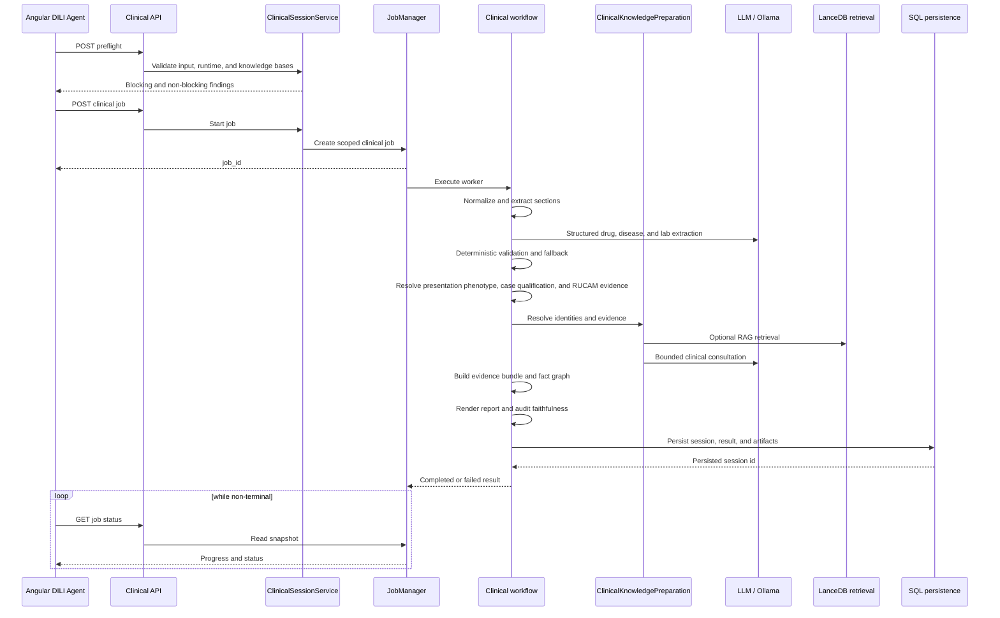

# DILI Assessment Pipeline
Last updated: 2026-10-29

## Section Extraction Contract
`POST /api/clinical/jobs` uses deterministic section extraction for structural input splitting. The extractor preserves source-verbatim section bodies after newline normalization and records canonical key, payload key, raw and normalized heading, match strategy, confidence score, heading line span, body line span, character span, verbatim coherence, review requirement, and source hash.

LLM fallback is not part of section extraction. Content inference, fallback assignment, low-confidence semantic matches, duplicate headings, or ambiguous headings are surfaced as diagnostics or review signals.

Aggregate section confidence is the minimum confidence across required extracted sections. Preflight blocks analysis when aggregate confidence is below `0.65`; confidence from `0.65` through below `0.85` is non-blocking but requires operator review acknowledgement in the DILI workspace before starting a job.

## Runtime Sequence

The application keeps deterministic grounding, model consultation, evidence
construction, faithfulness auditing, and mandatory persistence as distinct
stages.

## Structured Extraction Contract
Drug, disease, and laboratory extraction use provider-agnostic structured LLM calls for both cloud and local providers. The active runtime provider and model are resolved from persisted model configuration.

Structured LLM output is validated against Pydantic schemas and semantic guardrails. Invalid or contaminated output is retried with the rejected output and validation feedback. If bounded LLM attempts fail, the pipeline falls back to direct rule-based parsers and records fallback warnings.

Pre-flight preserves deterministic extraction counts as diagnostics, but it never asserts that anamnesis is disease-free solely because deterministic matching found no entries. Disease absence is a clinical conclusion, not a parser-gateway condition.

Therapy extraction is always full-section and context-aware when a structured model is available. The complete normalized therapy corpus is submitted in one structured request so medication names, schedules, and continuation lines remain associated across line breaks. Deterministic extraction is retained as a grounding reference and failure fallback, not as a reason to skip corpus-level extraction.

Structured output parsing accepts strict JSON objects only. Prose-wrapped JSON or trailing prose is rejected by default; repair logs include schema name, attempt count, output length, short output hash, and error type, but not raw model output.

For local Ollama extraction, disease and laboratory stages use compact structured payloads and schema-echo repair guards to reduce failure rates on smaller local models while preserving the persisted downstream result shape.

## Strategy Matrix
Therapy, anamnesis, disease, and laboratory extraction attempt structured LLM extraction first when a configured provider is available.

- `llm`: structured LLM extraction produced schema-valid, semantically acceptable output.
- `hybrid`: structured LLM extraction succeeded but direct rule-based evidence is retained for audit or fallback support.
- `deterministic`: bounded LLM attempts failed or no structured client was available, so direct rule-based parsing was used.

Clinical job result payloads include runtime diagnostics for extraction stages: resolved provider and model, stage elapsed time, fallback reasons, and structured failure kinds when a bounded structured stage falls back.

## Hepatic Pattern Resolution
If an explicit hepatic pattern is present in the laboratory source, it becomes the final pattern with source `provided`. The calculated R-ratio pattern is preserved separately. If both exist and differ, the pipeline emits `hepatic_pattern_source_calculation_conflict`.

If no explicit pattern exists, the calculated value is used. If neither is available, the final value is `indeterminate` with source `undetermined`.

Calculated DILI phenotype uses paired ALT and ALP values from the presentation or first qualifying injury episode, not the later peak ALT as the primary phenotype anchor. The R ratio is calculated from the contemporaneous normalized multiples `ALT / ALT_ULN` and `ALP / ALP_ULN`. Boundary values follow the clinical definitions used by the application: `R >= 5` is hepatocellular, `R <= 2` is cholestatic, and values between 2 and 5 are mixed.

Peak and later recovery pairs remain longitudinal audit points when available, but they do not replace the presentation phenotype used for downstream causality reasoning. Candidate selection compares normalized multiples rather than raw laboratory values so laboratory-specific ULNs are respected. When the required ALT, ALP, or corresponding ULN evidence is not sufficient for a reliable R ratio, the pattern remains `indeterminate` rather than substituting AST or an unrelated laboratory reference.

## Structured DILI Adjudication
The final report is generated from a persisted `DiliEvidenceBundle` before any
LLM summary. The bundle contains case completeness, explicit case qualification,
longitudinal exposure and laboratory events, presentation and longitudinal
R-ratio assessments, deterministic phenotype candidates, a mandatory
competing-cause checklist, Hy's Law status, explicit severity grade,
conservative drug identity resolution, per-drug RUCAM evidence, and a separate
internal structured causality synthesis.

Case qualification is intentionally separate from drug attribution. It records whether available laboratory evidence meets the EASL 2019 biochemical criteria, whether repeat testing is recommended, and whether an abnormal pretreatment baseline changes the reference used for interpretation. A qualifying episode does not itself establish DILI or implicate a specific drug.

The criteria are ALT/AST ≥5× reference, ALP ≥2× reference, or ALT/AST ≥3× reference with total bilirubin >2× reference within one day. The reference is the ULN, or the pretreatment value when that baseline is abnormal. A single qualifying panel qualifies, and `pending_confirmation` then notes that repeat testing is recommended. Bilirubin multiples compare value and reference in mg/dL (µmol/L ÷ 17.1), so a value and ULN in different units still compare correctly. INR >1.5 with elevated enzymes is only a supporting rationale note, never a qualifying criterion. When nothing qualifies and an ALT, AST or ALP value has no ULN or baseline reference, the status is `insufficient_data`, not `below_typical_detection_criteria`.

The clinical source hierarchy is AASLD, LiverTox, FDA DILI guidance, then DILIN expert methodology and RUCAM. RUCAM remains supportive and never dispositive. An explicitly documented RUCAM score from the current patient's clinical record is preserved as patient-specific evidence and mapped to its causality category. When no patient RUCAM score is supplied, DILIGENT does not synthesize a numeric pseudo-RUCAM score. It retains a non-scoring criterion-level evidence checklist and its limitations instead. RUCAM scores reported in LiverTox monographs, papers, or representative cases are never promoted to the current patient.

A patient-record score is read only when it follows `RUCAM` directly (`RUCAM: 6`) or through score/total wording in the same sentence (`RUCAM 2016 ... total score 5`, `RUCAM score of 7`); a year is never read as a score. Scores are clamped to the updated RUCAM range of −9 to +14. The category is always the score band. A differing stated category is kept as `stated_category` and recorded as a limitation; it never overrides the band.

LiverTox likelihood describes a drug-level prior hepatotoxicity classification and remains separate from patient-specific causality. Stored values are validated where they are read (`services/clinical/livertox_likelihood.py`): only A, B, C, D, E, E* and X are grades, qualifiers such as `[HD]` are dropped, and anything else, including `NAN` from missing table cells, is treated as unknown. A weak or sparse LiverTox prior can limit the available reference support, but it does not impose an artificial hard ceiling on patient-level causality when stronger patient evidence exists.

FDA DILIrank 2.0 is handled by the same principle. A linked DILIrank record contributes structured drug-level context such as `vDILI-Concern`, severity class, label section, and source comment. It is never converted into a numeric patient-causality weight and never overrides chronology, dechallenge or rechallenge, phenotype, competing causes, or patient-specific evidence. Only deterministic links to the canonical drug identity are eligible for clinical use; unlinked or ambiguous FDA rows remain inspection-only. When DILIrank evidence is supplied to a per-drug consultation, its LTKB identifiers are recorded in existing assessment provenance metadata and the rendered source label includes `FDA DILIrank 2.0` conditionally.

The internal structured causality synthesis integrates auditable patient evidence such as drug identity, chronology, drug-specific dechallenge or rechallenge evidence, phenotype information, competing causes, and source quality. Rechallenge is `positive` only with documented recurrence (RUCAM 2016): explicit wording such as `rechallenge: positive` or `positive rechallenge`, or re-exposure with a laboratory re-elevation in the same sentence. A bare restart or resumption stays `present_unclear`. A positive rechallenge gives `supportive` only when all major competing causes are excluded; otherwise synthesis is capped at `limited`. It is an internal deterministic synthesis for review, not a validated DILIN score and not a replacement for expert adjudication.

The deterministic dossier provides the FDA-style fourteen-section report
structure. The bundle also carries twelve acceptance-question answers with
supporting quotes and explicit missing-data statements so the final
adjudication can be audited directly.

The persisted `final_report` is the human-readable clinical DILI report. It
restores per-drug clinical narrative from the consultation synthesis and appends
a concise deterministic adjudication summary. The full rendered deterministic
dossier is persisted separately as `pipeline_artifacts.structured_dili_report`,
with the unchanged `dili_evidence_bundle` as the authoritative structured audit
contract. LLM clinical synthesis must remain evidence-bounded and is not allowed
to introduce unsupported clinical facts.

The result field `clinical_validity` is `no_automated_issues_detected` when no
automated gate fired and `requires_human_review` otherwise. It never states
clinical validation.

Blocking faithfulness issues are finalization blockers. The workflow may retain
generated artifacts for audit, but the persisted session status must not remain
`successful` when blocking faithfulness issues exist. Such cases require human
review before clinical reliance.

Generated clinical narrative is checked against the authoritative evidence
bundle before finalization. If the narrative claims that unresolved competing
causes were excluded, asserts Hy's Law when the structured status is not
`meets_criteria`, conflates LiverTox likelihood with patient-level causality, or
uses definitive/lifelong causality language while structured causality is limited,
the workflow records a blocking faithfulness issue and persists the session as
requiring human review rather than `successful`.

Structured claim checks extend the phrase gate. They judge patient claims
only: a sentence carrying drug-level or reference wording (LiverTox, literature,
typical, described, reported cases, recognized, can cause) is not checked for
pattern names or latency.
- `clinical_narrative_contradicts_injury_pattern`: a sentence naming exactly one
  pattern that matches no calculated bundle pattern, or a stated R ratio band
  (≥5 hepatocellular, ≤2 cholestatic) that matches none and is not introduced by
  reference wording. "Hepatocellular-cholestatic" reads as mixed, and sentences
  comparing several patterns are skipped.
- `clinical_narrative_contradicts_cause_status`: a clause that names a specific
  competing cause and calls it ruled out, excluded or eliminated while the
  differential does not mark it `excluded`; "unlikely" is flagged only for a
  `not_excluded` cause. Negated or conditional wording ("cannot be excluded",
  "should be excluded") is not a claim.
- `clinical_narrative_contradicts_latency`: a stated patient latency (decimals
  such as "8.3 weeks" included, range bounds ignored) that is off by more than
  both 14 days and 50% from every drug-start-to-onset interval, where onset is
  the first abnormal test, first symptom or bilirubin rise.
- Definitive causality wording such as "the definite cause" or "very likely
  responsible" counts as `clinical_narrative_overstates_causality`. LiverTox
  category wording ("highly likely cause") does not.

The same deterministic clinical safety audit is applied to agentic report revisions before a revised report can be persisted as a successful revision. LLM QA therefore cannot override contradictions with the structured competing-cause, Hy's Law, causality-certainty, LiverTox-provenance, or rechallenge safeguards.

Longitudinal adjudication is clinically conservative by default: dose changes,
restart or rechallenge mentions, first symptoms, bilirubin or jaundice timing,
marker-specific peaks, dechallenge direction, recovery versus persistence, and
worsening after discontinuation remain explicit timeline events or missing-data
statements instead of being inferred as negatives. Dechallenge evidence is interpreted per drug and requires a documented discontinuation context for that exposure; a global laboratory improvement is not automatically attributed to every medication in a polypharmacy case.

Case-level and per-drug dechallenge share one implementation that follows the
updated RUCAM course criteria. The course marker is ALT (AST when ALT is
absent) for hepatocellular injury and ALP for cholestatic or mixed injury.
Improvement means a decline of at least 50% of the peak excess over the
reference within 30 days (hepatocellular) or 180 days (cholestatic/mixed) of
discontinuation. The reference is the ULN, or the abnormal pre-treatment
baseline when one exists. `resolved_to_baseline` and a recovery date are
recorded only when the marker returns to that reference; a fall below an
earlier abnormal value is never treated as resolution. Abnormality beyond the
window without such a decline is `chronic_or_persistent`. The case-level
course follows the first discontinuation made once injury was present.

Mandatory competing causes use explicit four-state outputs:
- `excluded`
- `not_excluded`
- `unknown`
- `missing_data`

Each competing cause is assessed clause by clause. Cause terms match at word
boundaries, a negation cue shortly before the term (`no`, `without`, `denies`,
`negative for`) excludes it in that clause, and positive or quantified findings
(`positive`, `detected`, `dilated`, `60 g/day`) keep it competing. Across
clauses, presence outranks uncertainty, which outranks exclusion, so a negative
test for one agent never excludes a documented positive finding for another.

Pre-existing or chronic liver disease is retained as baseline context and a potential competing explanation rather than being treated as automatically excluded merely because it predates the acute episode. The differential remains unresolved unless the available evidence supports exclusion of the relevant alternative explanation.

Hy's Law evaluation is same-episode aware and records baseline multiples,
initial cholestasis, alternative-cause exclusion, exposure compatibility, and
individual-patient versus trial-signal context. Rechallenge remains a safety
signal only; the workflow never recommends rechallenge.

Initial cholestasis uses the ALP contemporaneous with the first ALT/AST ≥3× ULN
result (same panel, or the nearest ALP within 7 days), never the first ALP ever
recorded. ALP ≥2× ULN at that point marks cholestatic injury and gives `not_met`
(FDA 2009). `possible` is reserved for an otherwise qualifying episode whose
alternative-cause exclusion, exposure timing or onset ALP is unresolved.

Severity follows the DILIN scale (Fontana 2009). Total bilirubin is compared in
mg/dL; µmol/L is divided by 17.1, and a unitless value is read from its ULN
magnitude.
- 1 mild: bilirubin < 2.5 mg/dL and INR < 1.5.
- 2 moderate: bilirubin ≥ 2.5 mg/dL or INR ≥ 1.5.
- 3 moderate-severe: bilirubin ≥ 2.5 mg/dL and liver-related hospitalization.
- 4 severe: bilirubin ≥ 2.5 mg/dL and INR ≥ 1.5, ascites, encephalopathy or
  other organ failure.
- 5: death or liver transplantation.

Clinical events are matched sentence by sentence. A negation cue, a family
member, history wording (`history of`, `prior`) or hypothetical/planned wording
(`risk of`, `evaluated for`) in the clause before the term discards it.
Hospitalization counts only when the sentence names a liver-related reason, and
transplant only when it is a liver transplant.

## Match Audit
Drug identity comes from the database-backed terminology resolver described in [drug_terminology.md](drug_terminology.md). Extracted mentions are normalized once, regimen parents and components are preserved separately, each mention resolves to a terminology concept (exact alias, combination, curated variant, strict spelling gate, then the bounded RxNav fallback), and LiverTox evidence is attached only through explicit `drug_livertox_links` for an accepted identity.

Each matched-drug payload keeps the raw extracted name, the resolved concept and ingredients, the full `terminology` object (status, method, matched alias, source and version, candidates, review reasons, strength support), the linked LiverTox candidates with their link type, the decision status and reasons, origins, raw mentions, extraction metadata, and the full `DrugResolutionDecision`. There is no confidence score; the terminology status is the identity signal.

Candidate admission is intentionally high recall: structurally plausible medication labels are not discarded merely because they lack an exact local alias or recognized INN suffix. A label that does not resolve stays explicit as `unresolved`.

Before candidate selection and downstream RUCAM, retrieval, matching, and consultation, therapy and anamnesis mentions are deduplicated by normalized identity. Raw section entries remain available for audit, while the deduplicated artifact records origins, raw mentions, evidence snippets, and the selected clinical entry. When therapy and anamnesis give different start or stop dates for the same patient drug, `find_drug_date_conflicts` raises the blocking issue `drug_date_conflict` instead of silently keeping one entry.

Candidate selection keeps a stopped exposure, including an anamnesis-only one, in the consultation set when its stop date is no more than 30 days before injury onset (the RUCAM 2016 bound for cholestatic or mixed injury) and its start is not after onset. Onset comes from the onset context, with the visit date as fallback. The historical penalty applies only to exposures outside that window.

When a plausible mention remains unresolved or ambiguous, or has no linked monograph, the configured parser model may propose generic names, alternate names, or active ingredients in one structured batch. These proposals are candidate generation only. Each proposal is resolved again locally, and it is used only if it reaches a `verified` identity with a linked LiverTox monograph. Unvalidated or ambiguous proposals remain unresolved and auditable. An accepted payload is keyed by its resolved concept name, for example `acetaminophen` for `Dafalgan`. Matched-drug payloads, the DILI evidence bundle and the match audit therefore look payloads up by raw mention as well (`index_resolved_drugs`).

A combination concept without its own monograph is split into its ingredients so each keeps its own evidence; a combination monograph (for example Trimethoprim-Sulfamethoxazole) is reached through a `component_set` link.

Decision statuses are:
- `accepted_verified`
- `accepted_probable` (spelling-corrected; requires review)
- `missing_livertox` (accepted identity, no linked monograph)
- `ambiguous_requires_review`
- `unresolved`
- `rejected_false_positive`

An available LiverTox excerpt means evidence text is available for the accepted monograph. It is not treated as proof that a ranked or ambiguous candidate is clinically correct.

Pipeline issues are `drug_identity_unresolved`, `drug_identity_ambiguous` (with candidate names), `drug_identity_probable`, `drug_composition_unverified`, and `livertox_link_missing`. The final report begins with a "Drug identification" table listing each entered name, its resolved ingredients, identity status, and source.

Before session persistence, the matched-drug payload carries the accepted concept as `drug_id`. `ClinicalSessionRepository` stores each mention with its terminology status and audit fields and never learns aliases. After the session is committed, `ClinicalKnowledgePreparation.record_drug_mention_observations` records mentions without an accepted identity as runtime vocabulary observations. Terminology aliases are created only by source imports, verified RxNav relations, and explicit reviewer decisions.

DILIrank linking is a separate source-ingestion concern and does not add another clinical drug resolver. During DILIrank refresh, the FDA compound name first matches `drugs.canonical_name_norm`; only if no canonical match exists may a unique exact `verified` or `confirmed` alias from trusted `livertox` or `rxnorm` aliases link the row. Session-observed or manual aliases are excluded from this path. Multiple alias candidates leave the DILIrank row unlinked rather than guessing.

Per-drug clinical assessments carry claim envelopes and narrative limits. Claim review output distinguishes source-text claims, patient-record RUCAM claims, non-scoring RUCAM evidence, unsupported or unknown-source claims, and generated limitations so report consumers can see which statements require review.

The rendered per-drug report consolidates evidence-match status, the matched local record, evidence warnings, claim-review requirements, and RUCAM limitations into one localized clinical commentary. The structured claim and evidence fields remain unchanged in persisted audit data.

## RAG Readiness
Clinical preflight reports whether the configured RAG embedding backend is ready. When the active vector index depends on Ollama embeddings, Ollama and the configured embedding model must be available before a RAG-enabled job starts.

If Ollama is unavailable, the DILI Agent offers three explicit choices: retry after starting Ollama, run the pending assessment once without RAG, or cancel. Running without RAG does not change the saved model configuration. Job submission repeats the readiness check to prevent a stale successful preflight from starting a RAG-enabled job after the dependency becomes unavailable.

If retrieval becomes unavailable after a job starts, the report continues safely without supporting RAG documents and records one aggregated pipeline warning listing the affected drugs.

When RAG is enabled, retrieved text is used only as hidden model context. The final report bibliography lists compact references to retrieved documents by filename and page number only.

RAG ingestion computes a SHA-256 fingerprint over the raw bytes of each
supported input file. Only byte-identical files are grouped; semantic or
normalized-text deduplication is not performed. The canonical source is chosen
deterministically by normalized relative-path ordering and keeps the existing
path-derived `document_id`. Duplicate relative paths remain visible in Data
Inspection and are carried as alias metadata on the canonical document.
Embedding and chunking run once for the canonical source, while manifests
report physical supported files separately from unique ingested documents and
duplicate files. Citations use the canonical source and retain duplicate-source
metadata for auditability.

LiverTox input preparation is bounded for cloud and local providers. A timeout
produces an explicit pipeline warning and safe evidence-free continuation instead
of leaving the job indefinitely in Step 12. Progress text distinguishes
LiverTox-only preparation from RAG/vector-enabled retrieval.

Default Ollama embedding configuration must use an immutable model tag rather
than `:latest`, and vector collection reset is opt-in rather than enabled by
default.

## Timeline Grounding
Patient timeline extraction keeps month-only tokens such as `YYYY-MM` as
month-precision values and does not promote them to exact calendar days.

Numeric clinical dates are parsed by one shared parser
(`common/utils/clinical_dates.py`). The day/month order is inferred per record
from unambiguous tokens (for example `05/20/2024` proves month-first) and
applied to laboratory and therapy dates, which are normalized to ISO. Year-less
dates take the visit year, or the previous year when they would otherwise fall
after the visit. When the order matters but the record does not settle it,
dates are read day-first and the blocking issue `ambiguous_date_order` sends
the session to human review.

The drug extraction prompts state that the end date of a range (`from X to Y`,
`X to Y`, `X - Y`, `until Y`) is the suspension date. After extraction,
`DrugRulesMixin.normalize_entry` checks this deterministically. When
`suspension_date` is empty and the evidence sentence naming the drug contains
exactly one such parseable end date, that date fills `suspension_date` and sets
`suspension_status`.

The first abnormal liver test, which anchors latency and per-drug temporal
compatibility, considers only ALT, AST, ALP and total bilirubin on or after the
earliest exposure start. Each marker is compared with its reference: the ULN, or
the last pre-exposure value when that baseline is abnormal (EASL 2019). When no
marker qualifies the date stays missing; no normal or pre-exposure laboratory is
used as a fallback. A chronic pre-existing elevation therefore does not mark a
later drug as `incompatible_pre_exposure`. The trade-off is that an acute injury
that began just before exposure is anchored on its later rise, so per-drug review
must still weigh the pre-exposure values.

Anamnesis jaundice and symptom mentions are ignored when negated in their
clause, and a textual bilirubin mention counts as a rise only with an increase
cue. Bilirubin peak dates rank `TBIL` and `BILIRUBIN` entries together by ULN
multiple.

Deterministic laboratory parsing treats `(ref a-b)`, `(a-b)` and
`normal range a-b` as reference ranges whose upper bound is the ULN when no
explicit ULN is given. Range bounds and negative numbers are never emitted as
values. Recognized units include U/L, µmol/L, µkat/L, mg/dL and g/L, and
`Bil tot` is a total-bilirubin alias.

LLM-generated timeline events require preserved source evidence to remain in the
normalized event set. Events without source evidence are dropped rather than
persisted as clinically grounded chronology.

Deterministic fallback timeline events keep `timing_type="uncertain"` and do
not reuse the patient visit date as an invented exact event date.

## Failure Modes
- Missing required sections block structural preprocessing.
- Duplicate required headings block deterministic section extraction.
- Ambiguous or low-confidence section assignments require review.
- Missing or ambiguous external drug matches do not force a match.
- Ambiguous drug matches are included for review but are not used as authoritative LiverTox evidence.
- Unlinked or ambiguously linked DILIrank rows remain inspection-only and are not supplied to clinical consultation.
- Broad categories and rejected false-positive extracted text remain audit-only and do not become concrete drug matches.
- LLM structured output failures fall back to direct deterministic parsing after bounded retries.
- Missing patient-level RUCAM data never trigger a synthesized numeric RUCAM score; the pipeline retains a non-scoring evidence checklist instead.
- Session persistence is mandatory for successful clinical jobs. Persistence write failures raise a service dependency error instead of returning an apparently successful unpersisted report.
- Failed job payloads omit raw clinical input and patient image content; job-level errors expose generic failure text plus sanitized failure metadata.

## Testing Matrix
Regression fixtures under `app/tests/fixtures/dili_pipeline_audit` cover clean, noisy, incomplete, and adversarial clinical documents, including duplicate headings, ambiguous headings, structured and unstructured therapy, structured and noisy laboratories, hepatic-pattern conflicts, family-history disease mentions, allergy-only drug mentions, negated diagnoses, combination therapy, brand/generic variants, and missing LiverTox matches.

Focused clinical correctness unit coverage additionally checks presentation-versus-peak phenotype behavior, laboratory-specific ULN handling, missing-ULN and AST-substitution safeguards, patient-only RUCAM provenance, polypharmacy attribution, baseline-aware case qualification, drug-specific dechallenge, weak LiverTox prior handling, competing-cause semantics, onset-ALP Hy's Law, DILIN severity with negation-aware events, patient-record RUCAM parsing, baseline-aware episode anchoring, EASL single-panel and bilirubin-combined qualification, recurrence-based rechallenge, range stop-date recovery, recently stopped anamnesis drugs, therapy/anamnesis date conflicts, LiverTox likelihood validation, terminology identity warnings, explicit LiverTox link types, reference-range lab parsing, structured narrative claim checks, deterministic safety auditing of revised reports, DILIrank trusted-linking semantics, source-provenance attribution, and failed/cancelled DILIrank cache refresh behavior.
