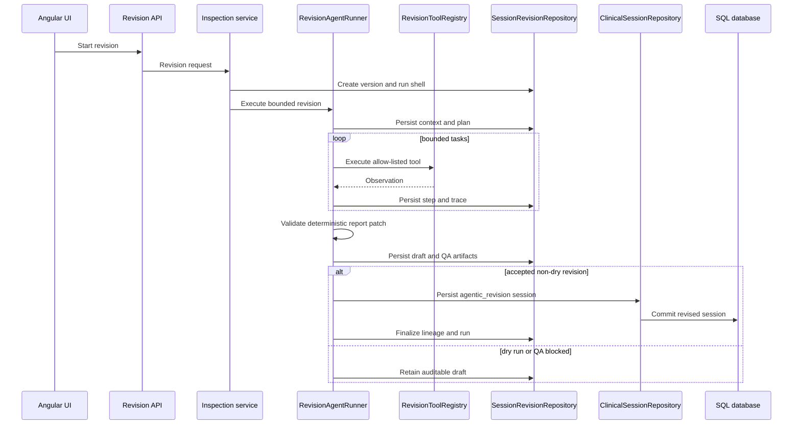

# Persistence
Last updated: 2026-10-29

## Relational Database

- SQLAlchemy-backed storage.
- The selected backend and database connection settings are read from
  `<data-root>/database_config.json`, independently of the configured database.
- Supported backends are SQLite and PostgreSQL through `psycopg`. SQLite uses
  `<data-root>/database.db` unless a different path is selected in Settings;
  source-mode data root defaults to `data` and can be overridden with
  `DILIGENT_DATA_PATH`.
- The configuration file contains only database connection settings. It is
  versioned, schema-validated, and atomically replaced. PostgreSQL passwords
  are protected with Windows DPAPI and excluded from API responses.
- All other UI-managed application settings, including the
  `application_configuration` singleton, are stored only in the active database.
  No JSON fallback or synchronization between databases is used.

## Relational Model

The relational schema keeps clinical sessions, immutable revision lineage,
knowledge/catalog data, configuration, and access keys in one SQLAlchemy
metadata graph. Vector documents remain in LanceDB and are intentionally not
foreign-keyed into this schema.

```mermaid
erDiagram
    CLINICAL_SESSIONS {
        int id PK
        string patient_name
        datetime session_timestamp
        string session_status
        string session_kind
    }
    CLINICAL_INPUT_DRAFTS {
        int id PK
        string draft_key
        int revision
        boolean is_active
        string patient_name
        date visit_date
        text clinical_input
        boolean use_rag
        datetime updated_at
    }
    CLINICAL_SESSION_RESULTS {
        int id PK
        int session_id FK
        json payload_json
    }
    CLINICAL_SESSION_SECTIONS {
        int id PK
        int session_id FK
        string section_kind
        text content
    }
    CLINICAL_SESSION_TIMELINES {
        int id PK
        int session_id FK
        datetime generated_at
        string generation_status
        json timeline_payload_json
    }
    CLINICAL_LAB_OBSERVATIONS {
        int id PK
        int session_id FK
        string marker_name
        float value
        date sample_date
    }
    CLINICAL_DRUG_MENTIONS {
        int id PK
        int session_id FK
        int drug_id FK
        int mention_ordinal
        string raw_mention
        string match_status
    }
    CLINICAL_SESSION_VERSIONS {
        int id PK
        int session_id FK
        int root_session_id FK
        int source_version_id FK
        int version_number
        string revision_kind
        string version_status
    }
    CLINICAL_SESSION_REVISION_RUNS {
        int id PK
        string pipeline_run_id UK
        int session_id FK
        int source_version_id FK
        int target_revision_version_id FK
        string status
    }
    CLINICAL_SESSION_REVISION_STEPS {
        int id PK
        int run_id FK
        string pipeline_run_id
        string step_name
        int attempt
        string status
    }
    CLINICAL_SESSION_REVISION_ARTIFACTS {
        int id PK
        int run_id FK
        int revision_version_id FK
        string artifact_key
        string status
    }
    CLINICAL_SESSION_REVISION_REVIEWS {
        int id PK
        int revision_version_id FK
        int session_id FK
        string review_status
    }
    DRUGS {
        int id PK
        string canonical_name
        string canonical_name_norm
        string concept_type
        string preferred_inn
    }
    DRUG_RXNORM_CODES {
        int id PK
        int drug_id FK
        string rxcui UK
    }
    DRUG_ALIASES {
        int id PK
        int drug_id FK
        string alias
        string alias_norm
        string source
        string validation_status
    }
    DRUG_CONCEPT_RELATIONS {
        int id PK
        int drug_id FK
        int related_drug_id FK
        string relation_type
    }
    MEDICINAL_PRODUCTS {
        int id PK
        int drug_id FK
        string source_product_id
        string composition_status
    }
    DRUG_LIVERTOX_LINKS {
        int id PK
        int drug_id FK
        int monograph_id FK
        string link_type
    }
    TERMINOLOGY_IMPORT_RUNS {
        int id PK
        string source
        string status
        json stats_json
    }
    DRUG_IDENTIFIERS {
        int id PK
        int drug_id FK
        string identifier_system
        string identifier_value
    }
    LIVERTOX_MONOGRAPHS {
        int id PK
        int drug_id FK
        string monograph_key UK
    }
    DILIRANK_RECORDS {
        int id PK
        int drug_id FK
        string ltkb_id UK
        string compound_name
        int severity_class
        string dili_concern
    }
    KB_MATCH_CACHE {
        int id PK
        int drug_id FK
        string normalized_key
        string source
        string resolution_status
        datetime expires_at
    }
    ACCESS_KEYS {
        int id PK
        string provider
        text encrypted_value
        boolean is_active
        string fingerprint
    }
    APPLICATION_CONFIGURATION {
        int id PK
        int revision
        json payload
    }
    PROVIDER_MODEL_CATALOG_CACHE {
        string provider_id PK
        string configuration_fingerprint
        json models
    }
    REFERENCE_CATALOG_ENTRIES {
        int id PK
        string manifest
        int manifest_version
        string domain
        string category
        string key
    }
    REFERENCE_CATALOG_MANIFESTS {
        int id PK
        string manifest UK
        int installed_version
        string manifest_hash
    }

    CLINICAL_SESSIONS ||--o| CLINICAL_SESSION_RESULTS : result
    CLINICAL_SESSIONS ||--o{ CLINICAL_SESSION_SECTIONS : sections
    CLINICAL_SESSIONS ||--o{ CLINICAL_SESSION_TIMELINES : timelines
    CLINICAL_SESSIONS ||--o{ CLINICAL_LAB_OBSERVATIONS : labs
    CLINICAL_SESSIONS ||--o{ CLINICAL_DRUG_MENTIONS : mentions
    CLINICAL_SESSIONS ||--o{ CLINICAL_SESSION_VERSIONS : versions
    CLINICAL_SESSION_VERSIONS o|--o{ CLINICAL_SESSION_VERSIONS : source_version
    CLINICAL_SESSIONS ||--o{ CLINICAL_SESSION_REVISION_RUNS : runs
    CLINICAL_SESSION_VERSIONS o|--o{ CLINICAL_SESSION_REVISION_RUNS : source
    CLINICAL_SESSION_VERSIONS o|--o{ CLINICAL_SESSION_REVISION_RUNS : target
    CLINICAL_SESSION_REVISION_RUNS o|--o{ CLINICAL_SESSION_REVISION_STEPS : steps
    CLINICAL_SESSION_REVISION_RUNS o|--o{ CLINICAL_SESSION_REVISION_ARTIFACTS : artifacts
    CLINICAL_SESSION_VERSIONS ||--o{ CLINICAL_SESSION_REVISION_ARTIFACTS : version_artifacts
    CLINICAL_SESSION_VERSIONS ||--o{ CLINICAL_SESSION_REVISION_REVIEWS : reviews
    CLINICAL_SESSIONS o|--o{ CLINICAL_SESSION_REVISION_REVIEWS : session_reviews
    DRUGS ||--o{ DRUG_RXNORM_CODES : rxnorm
    DRUGS ||--o{ DRUG_ALIASES : aliases
    DRUGS ||--o{ DRUG_IDENTIFIERS : identifiers
    DRUGS ||--o{ LIVERTOX_MONOGRAPHS : monographs
    DRUGS ||--o{ DRUG_CONCEPT_RELATIONS : relations
    DRUGS o|--o{ MEDICINAL_PRODUCTS : products
    DRUGS ||--o{ DRUG_LIVERTOX_LINKS : livertox_links
    LIVERTOX_MONOGRAPHS ||--o{ DRUG_LIVERTOX_LINKS : linked_concepts
    DRUGS o|--o{ DILIRANK_RECORDS : dilirank
    DRUGS o|--o{ KB_MATCH_CACHE : cached_matches
    DRUGS o|--o{ CLINICAL_DRUG_MENTIONS : resolves
```

## Persisted Clinical Session Contract

- `clinical_sessions` is the source of truth for session records and metadata.
- `clinical_session_versions` owns immutable version lineage, root-session relationships, version numbers, and manual edits.
- Revision tables own the bounded revision workflow and canonical artifacts:
  `clinical_session_versions`, `clinical_session_revision_runs`,
  `clinical_session_revision_steps`, `clinical_session_revision_artifacts`,
  and `clinical_session_revision_reviews`.
- Structured revision entities are stored as `structured_case_entity` rows in `clinical_session_revision_artifacts`.
- Manual report edits create immutable `clinical_session_versions` rows with `revision_kind=manual_edit`.
- Patient timeline history is persisted only in `clinical_session_timelines`; session result payloads are not a timeline read source.
- Timeline generation metadata stays on persisted timeline records and does not rewrite original clinical-session runtime metadata.
- Evidence-locked DILI artifacts in the database-backed session result payload are `normalized_document`, `extraction_artifact`, `fact_graph`, `faithfulness_audit`, generated report metadata, discrepancy report, and `dili_evidence_bundle_index`.
- Successful clinical workflows require persistence. Repository failures, missing persisted IDs, and failed upserts are service dependency failures rather than silent in-memory success.
- SQLite enables foreign keys, a 30-second busy timeout, and WAL journaling.
- Alembic is the authoritative schema-evolution mechanism. The shared
  `repositories.schemas.Base.metadata` is the autogenerate source of truth;
  application startup and explicit initialization never use `create_all()`.
- Startup and installation serialize migration attempts, inspect the current
  Alembic head, and apply pending revisions before repositories or services run.
- SQLite migrations that rebuild referenced tables temporarily disable foreign-key enforcement within the atomic migration transaction, run `PRAGMA foreign_key_check` before commit, and restore the prior enforcement setting. Any violation aborts the migration.
- Fresh databases are upgraded through the linear Alembic history before the
  application starts. The current head is `202610290001` (drug terminology
  resolution). The v2.4 baseline and revisions through `202610240001` remain
  available, so databases from the v3.5.x releases upgrade to the head without
  losing user rows. Populated
  databases without an Alembic revision and databases with unknown or
  divergent revisions are rejected before application tables are changed; the
  runtime never guesses or stamps migration history.
- SQLAlchemy update timestamps use an application-level update hook shared by SQLite and PostgreSQL.
- Version listing and detail reads are side-effect-free; synchronization is reserved for explicit write paths.
- Durable loose JSON or Markdown assessment files are not part of the runtime contract.
- Canonical repeated observations are stored in `clinical_lab_observations` and ordered drug mentions in `clinical_drug_mentions`.
- Access-key ciphertext remains in the database; versioned Fernet key material is stored in the protected `DILIGENT_ACCESS_KEY_MATERIAL_FILE` store.
- Canonical drug identifiers use `drug_identifiers` with unique `(identifier_system, identifier_value)` ownership.
- FDA DILIrank 2.0 rows are stored in `dilirank_records` as a source-complete snapshot. `ltkb_id` is unique. `drug_id` is nullable so unmatched or ambiguous FDA rows remain inspectable without inventing a canonical drug mapping. A linked row also receives a `drug_identifiers` entry using identifier system `dilirank_ltkb`.
- Complete RxNav and LiverTox refreshes reconcile their source-owned aliases, mappings, monographs, and source metadata after successful preparation in one database transaction. Shared `Drug` entities and records owned by other sources are preserved when obsolete source rows are removed.
- Drug terminology (`drugs` concept types, `drug_aliases` validation status and provenance, `drug_concept_relations`, `drug_atc_codes`, `medicinal_products`, `medicinal_product_ingredients`, `terminology_conflicts`, `terminology_import_runs`, `drug_livertox_links`) is described in [drug_terminology.md](drug_terminology.md). Only `verified` and `confirmed` aliases resolve; reviewer decisions use alias source `reviewer` and survive every source refresh.
- `application_configuration` is the fixed-ID singleton for validated configuration payloads, and `reference_catalog_manifests` records installed manifest state.

## Resumable Clinical Input Draft

- `clinical_input_drafts` is a fixed-ID singleton for the DILI Agent's one
  explicitly saved working draft. It is separate from clinical sessions,
  reports, revisions, and job records.
- The draft contains only patient name, visit date, exact clinical input text,
  and the per-run RAG choice. Patient images are excluded.
- Draft reads and writes use the active configured SQLite or PostgreSQL
  database. The database can be remote when PostgreSQL is configured.
- The browser does not store draft contents in `localStorage` or
  `sessionStorage`. A read presents a recovery choice without automatically
  replacing the in-memory form.
- Saves use the server-issued UUID and monotonic revision as conditional-write
  tokens. A token mismatch rejects the write, including when the active
  database changed. Discard clears all patient fields and advances a
  tombstone revision so delayed writes cannot restore deleted content.
- Draft endpoints do not run preflight, call a model, create a job, or create a
  clinical session. Submitting an assessment continues through the existing
  clinical pipeline.

## Focused Repository Ownership

- `KnowledgeRepository` owns LiverTox and existing evidence data.
- `DiliRankRepository` owns FDA DILIrank 2.0 source rows and their deterministic links to the canonical drug catalog.
- `DrugCatalogRepository` owns the Drug Catalog inspection reads, renames, and deletes.
- `TerminologyRepository` owns terminology import, reconciliation, and LiverTox link rebuilds; `TerminologyLookupRepository` owns runtime resolution reads, runtime aliases, and the resolution outcome cache; `TerminologyInspectionRepository` owns Knowledge > Terminology reads.
- `ClinicalSessionRepository` owns session-result persistence.
- `SessionTimelineRepository` owns timeline rows.
- `SessionRevisionRepository` owns revision data, steps, and artifacts.
- DILIrank linking accepts exact canonical drug names first, then exact aliases only from trusted `livertox` or `rxnorm` alias sources. Session-observed and manual aliases do not activate DILIrank evidence. Ambiguous and unmatched FDA rows remain unlinked.
- `ClinicalKnowledgePreparation` is the application-level coordinator for
  drug-identity resolution, runtime vocabulary observations, and knowledge
  match-cache updates. `ClinicalSessionRepository` persists resolved drug
  mentions and does not learn catalog aliases while saving a session.
- `DataInspectionService` coordinates cross-repository inspection responses and owns the canonical update-job dispatch for RxNav, LiverTox, terminology, DILIrank, and RAG; it combines clinical session detail with revision records rather than making either repository depend on the other. Session deletion follows the same ownership boundary: it asks `SessionRevisionRepository` to remove revision-owned rows before `ClinicalSessionRepository` removes the session.
- The combined structured-source job is the backend orchestration boundary for `RxNav -> LiverTox -> Terminology -> DILIrank`; RAG remains independent. Its child progress is exposed through the same inspection job status contract.
- Feature-specific file serialization remains separate from SQLAlchemy persistence. `RepositoryContext` supplies the shared engine/session factory, and application services receive only the focused repositories they need. Transactions remain explicit at the repository boundary, including atomic session persistence and batch ingestion.
- `repositories/serialization` is a mixed historical package: pure row and
  payload converters remain there, but access-key and model-configuration
  adapters also own SQLAlchemy queries, transactions, and commits. Public
  access-key operations return `AccessKeyRecord`; ORM rows remain internal to
  persistence and encryption code.

## Reference Catalog Persistence

- Canonical manifests live in `data/catalogs/*.json` and are seeded into database tables.
- RxNorm persistence uses `drug_rxnorm_codes` as the canonical RxCUI mapping table.
- Explicit database initialization seeds the canonical manifests after Alembic
  reaches head.
- SQLite startup creates the configured `.db` when missing and applies
  migrations. A new app schema or empty reference catalog is seeded; populated
  databases are not reset.
- PostgreSQL startup connects to the configured database, creates it when the
  configured credentials permit creation, and applies migrations. A new app
  schema or empty reference catalog is seeded. Existing application settings
  and user data are preserved; startup does not copy records from another
  database.
- Full reseed or reset remains explicit through `app/scripts/initialize_database.py --drop-existing --seed-catalogs --force-reseed-catalogs`.

## Vector Persistence

- LanceDB collections live under `data/sources/vectors`.
- RAG uses the immutable Granite embedding contract in `common/embedding/config.py`; index generations carry a versioned manifest and exact embedding fingerprint.

## Filesystem Data

- In development, `data/sources` contains persistent source catalogs, documents, archives, and vectors. The embedded database and access-key material also live in `data/`. Disposable embeddings and logs are stored under `runtimes/cache`.
- The validated FDA DILIrank workbook and its HTTP metadata cache live in the existing source archives location. New downloads are written to a candidate file and promoted only after workbook validation; failed or cancelled candidate refreshes do not replace the last-known-good cache.
- In packaged desktop mode, immutable catalogs live under the extracted runtime at `data/catalogs`, and Angular assets live in the same runtime. Databases, source documents, vectors, exports, state, and access-key material live directly under `%LOCALAPPDATA%\DILIGENT\data`, while disposable logs and embeddings live under `%LOCALAPPDATA%\DILIGENT\data\cache`.
- `data/catalogs` contains JSON seed manifests for database-backed reference catalogs and is copied to the immutable packaged runtime.

The extracted runtime is versioned and hash-addressed so it can be replaced during upgrades. The persistent data root is intentionally outside the runtime and is not removed by desktop artifact cleanup or MSI uninstall.

## Access Key Persistence

- Encrypted provider keys are persisted in database tables.
- Provider-scoped retrieval filters by both provider and key ID.
- The persistence constraint covers OpenAI, Gemini, DeepSeek, Anthropic, OpenCode, and Brave.

## Persistence Contract Validation

- `app/tests/persistence` runs against file-backed SQLite.
- When `TEST_DATABASE_URL` is configured, the same contract runs against PostgreSQL.
- CI runs both backends in the `persistence-contract` job.

## Model Configuration Persistence

- A newly initialized database receives canonical model defaults.
- Existing provider and model selections are read as stored; unsupported values fail validation and are not silently translated.
- Provider model catalogs are persisted in `provider_model_catalog_cache`, keyed by provider and a fingerprint of the catalog endpoint plus the active credential (or normalized Ollama endpoint). Secrets are never stored.
- `GET /api/model-config` reads cached catalog state only. The provider-specific `load` operation contacts a provider only for a cold cache, while `refresh` is the explicit replacement operation.
- Failed attempts are persisted with sanitized metadata. A failed cloud refresh preserves the last valid list; an empty Ollama installation is a valid cached result. Endpoint or active-key changes invalidate the old scope without affecting inactive credentials.
- The same SQLAlchemy schema is initialized for development and packaged desktop runtimes, so the persisted catalog survives navigation and application restarts without startup polling.

## Agentic Revision Artifacts

Revision runs persist bounded context, plan, tool traces, draft reports, QA,
and finalization artifacts. Successful non-dry runs create an
`agentic_revision` session and attach it to the pre-created version shell; QA
blockers persist as `qa_failed` drafts for human review.

